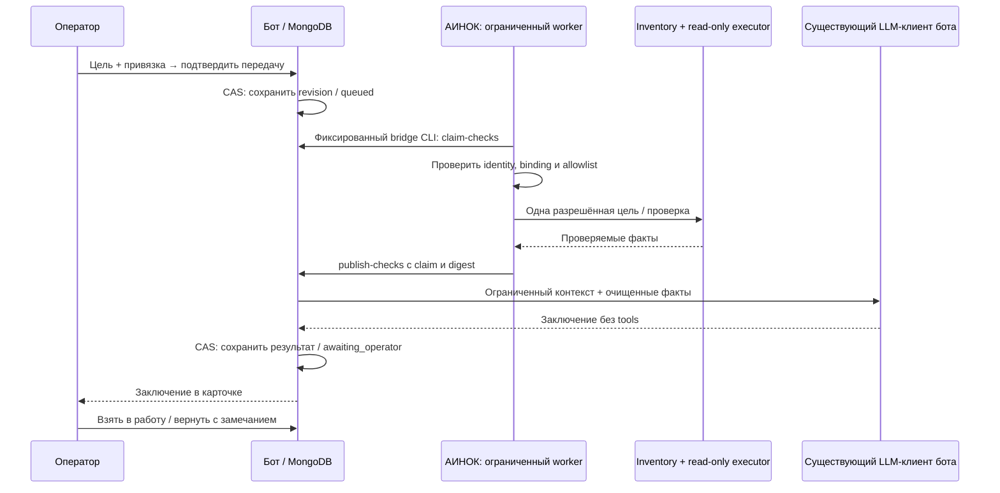

# Передача задания ИИ-инженеру — архитектура Stage 1

Версия: 1.2, 2026-10-19. Статус: одобрена независимым ревьюером для реализации; blocking findings нет.
История замечаний и вердикт: [AI_ENGINEER_ARCHITECTURE_REVIEW.md](reviews/AI_ENGINEER_ARCHITECTURE_REVIEW.md).
Реализация, production admission, включение и canary этим документом не подтверждаются.
При расхождении с предварительным `AI_ENGINEER_STAGE1.md` решения этого документа имеют приоритет.

## 1. Решение и границы

Передавать ИИ не роль владельца заявки, а отдельное сохраняемое задание внутри неё.
Оператор формулирует цель, подтверждает объект и отправляет задание; АИНОК собирает разрешённые факты; ИИ возвращает внутреннее заключение.
Оператор принимает заключение в работу, возвращает с замечаниями или отменяет задание. Клиент общается только с ботом.
Stage 1 не исполняет рекомендации, не закрывает заявку, не отправляет AI-ответ клиенту и не публикует навыки автоматически.

Проверенная база: бот `most-core@f317e34853548a7180cd6173e52dd0652811a58b`, контроллер AINOC наблюдался на `426fe8f`.
Перед реализацией проверить актуальность SHA и deployed image. Существующая production branch в registry — `most-core`, не `master`.
Список изученных точек: `ai-draft.ts`, `ticket-ui.ts:staffSurface/handleCallback/history`, `team.ts:canManageTicket`, `ticket-ownership.ts`, `ticket-state.ts`, `db.ts:getTicketTimelinePage`, `ticket-resolution-case.ts`, `async-work.ts`, `lifecycle.ts`.
На контроллере изучены `VM3902Transport` и `AgentOrchestrator.request_bounded_diagnosis/_diagnosis_plan`.
Первый является фиксированным transport развёртывания через существующий OpenSSH route → pmox8 → QGA; второй относится к инцидентам разработки с candidate SHA. Ни один не является готовым runtime-мостом тикетов.

## 2. Путь пользователя

1. В активной карточке: «🤖 Передать ИИ-инженеру».
2. Форма: цель 1–2000 символов; выбранная существующая подтверждённая привязка объекта; фиксированный набор read-only проверок. Предпросмотр показывает ограничения и ожидаемый результат.
3. «Передать задание» сохраняет его до подтверждения пользователю. На карточке виден отдельный статус ИИ, человеческий владелец сохраняется.
4. По завершении: «Заключение», «Взять заключение в работу», «Вернуть на доработку», «Отменить задание», «Технические детали».
5. Возврат открывает форму замечания 1–1000 символов и создаёт revision+1; предыдущая версия доступна в истории. Можно уточнить цель, но изменение объекта требует новой подтверждённой привязки.
6. «Взять заключение в работу» завершает AI-задание как `handed_off`; не подтверждает техническую правильность, не меняет lifecycle и не отправляет сообщение клиенту. Для неназначенной заявки действие явно предлагает существующее «Взять заявку» с ownership CAS.
7. Передача другому человеку выполняется существующим «Передать». Повторное обращение к ИИ после handoff создаёт новую revision с новой целью.

У каждого ввода actor/chat/thread/expiry/version; активные формы compose/manual intake/name editor/resolution взаимоисключаются с AI-формой.
Заключение видно только сотрудникам, в том числе при fallback чтении истории. Отказ/таймаут не мешают обычной поддержке.

## 3. Компоненты и размещение



Бот владеет постановкой, состоянием, контекстом, выводом ИИ и UI. Контроллер владеет доступом к инфраструктуре и допустимостью диагностик.
LLM вызывается через существующий клиент `src/addons/llm.ts`. Нового провайдера/агентского runtime не вводить, AI stack АИНОК не менять.
У модели нет tools, SSH, URL, CLI или права выбирать произвольные параметры. В первом этапе check IDs определяются серверным фиксированным профилем, а не моделью.

## 4. Выбранный транспорт: controller pull, без нового listener

Контроллер забирает задания и публикует факты по существующему admin route VM3902: OpenSSH к pmox8, затем QGA в точную VM3902.
Внутри VM выполняется только зафиксированный аргументами вызов Compose `exec -T supportbot node build/ai-engineer-bridge.js <operation>`; структурированные данные передаются stdin.
Новый bridge CLI имеет только `publish-catalog`, `claim-checks`, `publish-checks`, `request-status`, `cancel-checks`. Он подключается к существующей MongoDB из контейнера, не стартует Telegram polling и всегда закрывает соединение.
Команда, container/service, script path, VMID и deployment scope зафиксированы доверенным кодом. Данные запроса не превращаются в shell-строку. CLI требует строгую схему, ограничения полей/размера и отсутствие лишних ключей.
Controller-side sibling adapter переиспользует inventory route resolution и OpenSSHExecutor, но не вызывает deployment `activate/stage/rollback` и не расширяет VM3902Transport до generic guest-exec API.
Bot container не получает SSH/root credentials АИНОК. MongoDB не публикуется наружу. Inventory API остаётся loopback; DNS, firewall, proxy, Xray и сети не меняются.

Это новый фиксированный протокол поверх существующего маршрута, а не уже реализованная возможность transport. Его read-only canary ещё требуется; на данном этапе не выполнять Compose exec на проде.
Потребуется один ограниченный controller worker, запускаемый systemd timer с overlap lock и сроком выполнения, без слушающего сокета. Это необходимая lifecycle-единица доставки, не второй orchestrator.
Каждый запуск берёт максимум одно задание; период 15 секунд, не более одной проверки одновременно. Сбор ограничен 60 секундами, общий сбор с доставкой — 120 секундами. Lease сборщика — 180 секунд. Перезапуск завершает неопределённый исход по request-status, не повторяет команду вслепую.
Все вызовы QGA/transport имеют deadline. Максимальный UTF-8 JSON envelope 24 KiB до base64/обёртки; проверять итоговый размер against действительного лимита transport. Не наследовать deployment writer state или его глобальный lock на всё время LLM.
Из-за стоимости QGA это подход для малого объёма; новый HTTP endpoint/агент не нужен для первого подтверждённого сценария.

## 5. Доверенная привязка объекта

АИНОК хранит отдельный аддитивный mapping `support scope + binding_id + binding_version → canonical asset_id + permitted check profile + enabled + expiry` в своей существующей SQLite inventory.
Первоначальные bindings создаются только локальным доверенным оператором АИНОК через отдельную проверяемую операцию с аудитом; бот и модель не могут их создавать/расширять.
Перед claim controller worker публикует ограниченный каталог через фиксированный `publish-catalog`. Bot-side singleton `AIEngineerCatalog` содержит только scope, монотонную catalog_version, generated_at/expires_at и entries `{binding_id, binding_version, display_label, profile_id}`. IP, credentials, raw facts и полный inventory не передаются.
Каталог живёт 5 минут и принимается только для фиксированного scope; равная версия с другим digest — conflict, меньшая версия отвергается. Controller хранит monotonic publication catalog_version рядом с mapping в SQLite и повышает её при каждой новой публикации, включая обновление TTL без изменения entries. Version и точные bytes envelope сохраняются атомарно в SQLite до dispatch; transport retry повторяет ту же version/bytes, не продлевая expiry. Следующий refresh создаёт новую version/generated_at/expires_at, поэтому полный digest может включать timestamps без конфликта. Приём проверяет expires_at > now и expires_at - generated_at <= 5 минут с заданным clock skew. Пустой каталог новой version явно отзывает все отображаемые bindings; binding_version меняется только при изменении самой authority mapping.
Бот показывает пагинированный список только из свежего каталога; выбор и подтверждение сотрудника связывают заявку с binding_id/version. Несвежий/недоступный каталог блокирует confirmation, но не приём тикетов. Окончательная актуальность mapping проверяется контроллером, поэтому задержка публикации отзыва не даёт разрешения на новую проверку.
Stage 1 — внутренняя операторская поддержка: пользователь Telegram не получает доступ к инфраструктуре. Разрешённые сотрудники support deployment могут диагностировать только явно опубликованные ему объекты. Персональные клиентские зоны не предполагаются; до их введения нельзя публиковать в scope объекты, доступ к которым требует клиентской tenant-привязки.
Контроллер независимо проверяет scope, срок/версию binding, профиль, `management='ainoc' AND enabled=1`, canonical target и существующие capability/parameter guards на каждом сборе.
Поле asset_id/IP/hostname из текста заявки никогда не используется как authority. Project registry `support-bot` не является разрешением на инфраструктуру.
Без binding задание остаётся черновиком «Нужна привязка» и не отправляется на диагностику; общий AI-ответ по тексту не выдаётся за инфраструктурное заключение.
Первый профиль содержит одну проверенную операцию. `show_host_info` допустим только после проверки реального read-only registry metadata и маршрута; это проверка доступности/uptime, не диагностика VPN.

## 6. Контракты

Ключ задания: `deployment_scope + task_id(UUID) + revision(>=1)`; request_id(UUID) уникален на revision.
Слепая повторная доставка использует тот же request_id и те же байты digest. Изменение содержимого требует новой revision; равный ID с другим digest — conflict.
Доверенная сторона scope: controller adapter, настроенный на фиксированные VM3902/container/collection. Scope из payload обязан совпасть, он не выбирает канал доступа.

`TaskEnvelope v1`:

```json
{
  "schema": "support-engineer-task-v1",
  "deployment_scope": "most-support-vm3902",
  "task_id": "<uuid>", "request_id": "<uuid>", "ticket_id": 42,
  "revision": 1, "ticket_epoch": 3, "requested_by": "<staff-id>",
  "binding_id": "<operator-published-binding>", "binding_version": 1,
  "profile_id": "host-info-v1", "execution_allowed": false,
  "context_digest": "<sha256>", "authority_digest": "<sha256>",
  "policy_fingerprint": "<sha256>",
  "created_at": "<UTC>", "expires_at": "<UTC>"
}
```

Через границу контроллеру не отправлять body заявки, feedback или историю клиента — только envelope и привязки. Модель запускается в боте после получения фактов.
Authority digest вычисляется из серверного ticket_epoch, owner, actor role snapshot, scope, binding/version, profile, request_id, revision, policy_fingerprint и expiry; plain hash не является подписью и не заменяет проверку прав в действующей policy generation.
`claim-checks` возвращает envelope и новый непредсказуемый claim_id с lease_until. `publish-checks` принимает тот же envelope digest, claim_id и `CheckResult v1`:

```json
{
  "schema": "support-engineer-checks-v1", "request_id": "<uuid>",
  "revision": 1, "authority_digest": "<sha256>", "claim_id": "<uuid>",
  "status": "completed", "execution_allowed": false,
  "facts": [{"ref": "check-1", "check_id": "host-info-v1", "observed_at": "<UTC>",
    "values": {"reachable": true, "uptime_seconds": 123}}],
  "unknowns": [], "completed_at": "<UTC>"
}
```

Точные facts field/type определяются нормализатором проверенной capability; пример не является контрактом сырого show_host_info.
Статусы check result: `completed | partial | denied | failed`. Полноценное заключение возможно только с валидным минимумом фактов; при partial явно перечислить пробелы, denied/failed → оператору без уверенной причины.
Неизвестные поля, типы, чужой request, revision, claim, scope, expiry или digest отклоняются до публикации.
Все timestamps — UTC, expiry/lease проверяются серверным временем принимающей стороны; допустимый clock skew 5 секунд, наблюдаемый больший drift блокирует сбор.

Контекст модели — сохранённый snapshot цели, очищенной выбранной истории и замечания; до 8 KiB UTF-8. Snapshot неизменяем в revision, хранится внутренне, его hash — context_digest.
Факты — только allowlisted typed projection до 8 KiB. Вывод ИИ до 12 KiB: `summary`, `verified_findings` с существующими evidence refs, `hypotheses`, `unknowns`, `recommended_next_steps`, `customer_reply_draft`.
Неизвестный ref, невалидная схема или превышение лимита → failed. Модель не может объявить результат capability успешным или изменить execution_allowed.
Секреты исключаются из проекции до LLM; regex логгера не является защитой. В customer draft не должно быть инфраструктурных адресов/идентичностей/секретов; это дополнительный внутренний черновик, отправка только существующим человеческим reply flow.
Изменение новых сообщений после snapshot помечает вывод «По состоянию на ...; есть новые сообщения», не переписывает snapshot и не стартует новый платный запрос.

## 7. Состояния, хранение и атомарность

`draft` — форма; после подтверждения `queued → collecting → summarizing → awaiting_operator → handed_off`.
Отдельные terminal состояния: `failed`, `cancelled`, `stale`, `reworked`. `awaiting_operator` не terminal.
Возврат: CAS `awaiting_operator → reworked` сохраняет непустое замечание и immutable continuation intent `{operation_id, next_request_id, next_revision, next_context_snapshot/digest}` в том же документе. Эта CAS использует одноразовый UI intent token; повтор token возвращает уже сохранённый continuation, не создаёт новый UUID/revision.
После drain pending event архивировать неизменяемый terminal snapshot `reworked`, затем CAS заменить current revision на ровно next_revision/next_request_id из intent. Guard replacement содержит старые task/request/revision, terminal snapshot digest, ticket epoch/owner и policy fingerprint. Crash возобновляет тот же intent; новый пользовательский ввод не переписывает его.
Повтор failed/handed_off использует такой же сохранённый continuation intent до archive→replace, но сохраняет terminal outcome исходной версии. Новая revision всегда queued; завершённую запись обратно в queued не переводить.
Ошибка binding/прав до подтверждения не создаёт runnable task. После confirmation отказ контроллера становится failed с кодом отказа; повтор требует устранить причину.

Authority текущей работы хранится в аддитивном `Supportee.ai_engineer` вместе с `ai_epoch`; этот документ — один источник состояния active revision, outbox и publication guard.
Поля: task/request/revision, state, owner/role/binding snapshots, input snapshot/digests, expiry, collector/summarizer claim/lease, facts, conclusion, projection_pending.
Новая коллекция `AIEngineerRevision` хранит неизменяемый завершённый снимок с уникальным `(deployment_scope, ticketId, task_id, revision)` и request_id. Терминальные snapshots архивируются idempotent upsert с проверкой digest; конфликт не перезаписывается.
Snapshot включает frozen input/facts/conclusion/outcome и authority на момент задания; из digest исключены mutable projection acknowledgements, текущий ticket.ai_epoch, исходящий continuation intent и технические timestamps архивирования. Замечание, породившее revision, входит в её frozen input; замечание для следующей revision принадлежит next context. Существующий terminal outcome/вывод после архивирования не меняется: актуальность показывается отдельно по текущей authority.
Перед заменой текущей terminal revision новой сначала подтвердить архивирование. Ошибка архива блокирует только новую AI-revision, не работу поддержки. Crash между archive и CAS безопасен: повтор использует тот же digest и CAS старой revision.
Так текущий документ ограничен одним заданием, историю не хранить растущим массивом в 16 MiB документе MongoDB.

Все рабочие переходы — один CAS update Supportee: active lifecycle, текущий owner, ai_epoch, task/request/revision, ожидаемый state, claim и lease. Смена lifecycle/owner/привязки увеличивает ai_epoch в том же update, во всех существующих mutation paths. Эта инвалидация не перезаписывает сохранённые facts/conclusion/outcome или pending event.
Несовпадение current ai_epoch с frozen task ticket_epoch немедленно означает effective stale при любом чтении/claim/publication, независимо от успешности отложенной записи stale event. Уже terminal архив хранится без изменения.
Права actor из действующей policy generation повторно проверяются в боте при claim, publication и handoff. Controller перед каждой capability получает через фиксированный bridge актуальный request-status; lease не равна бессрочной авторизации. Изменение самой policy generation описано ниже и требует согласованного restart, а не редактирования config на работающем процессе.
Проверка и запуск отделены сетью: уже начатый read-only вызов может завершиться после отзыва. Его результат не становится текущим; новых проверок не начинать. Не обещать мгновенной отмены удалённого процесса.
На перегрузке максимум одно queued/running задание на заявку и одна collector/summarizer lease на revision. Устаревший worker не может записать результат с новым claim.
Lease summarizer 120 секунд, LLM timeout 45 секунд, одна попытка модели на полученный claim. Для вызова явно задать SDK-level `timeout=45000` и `maxRetries=0`; повтор обёртки/SDK не должен обходить attempt counter. Reclaim после crash допустим, но не обещает exactly-once оплаченного LLM-вызова; максимум 2 попытки на revision с резервированием attempt counter CAS до вызова, затем failed/operator.
Request expiry — 15 минут с confirmation; повтор/возврат дают новый срок и revision. Устаревшие факты старше 5 минут не использовать для нового заключения, показать stale и запросить новую revision.

Critical state + единственный projection_pending атомарны в Supportee. Любой обычный AI-переход требует пустого pending slot; CAS сохраняет ровно одно следующее событие со stable projection_id. Пока событие не записано idempotently, collection/summarization/rework/handoff/new revision не продвигаются. CLI возвращает retryable projection_pending вместо повторного исполнения.
Epoch invalidation обычным close/transfer/ban/rebind никогда не ждёт drain и не меняет pending slot. Worker сначала дописывает ранее сохранённое событие, затем отдельным CAS materializes effective stale и его событие, если current task epoch уже не совпал; архивированная terminal версия не изменяется. Это сохраняет последовательность событий без блокирования поддержки.
Acknowledgement очищает pending только по совпавшему projection_id. Событие и immutable archive обязательны; обновление Telegram-карточки best-effort и не удерживает pending slot бесконечно. Карточка читает authority из DB, поэтому отложенный UI не меняет состояние задания.
Projection/archive repair разрешён и при выключенном AI: он не собирает факты и не вызывает модель. Иначе отключённая функция могла бы навсегда удержать обязательные pending события.
Существующий AnalyticsEvent append генерирует новый UUID, поэтому для новых AI-событий нужен отдельный idempotent append с уникальным dedup key, а не повтор обычного append вслепую. Общий seq/cursor контракт сохранить.
AI-события: `ai.task_submitted`, `ai.checks_completed`, `ai.conclusion_created`, `ai.rework_requested`, `ai.handed_off`, `ai.failed`, `ai.cancelled`, `ai.stale`. Metadata содержит IDs/codes/digests, не body.
В timeline выводить метку и ссылку на AI-задание только в staff ветке. API/webhook projection не публикует body/feedback/evidence values, подписка на IDs не выдаёт инфраструктурный доступ.

## 8. Обработка сбоев и отключение

- Crash после submission: controller worker найдёт queued запись независимо от событий Telegram/webhook.
- Timeout claim/publish: request-status по прежнему request_id, затем точный replay; отсутствие transport ответа не доказывает отсутствие side effect в Mongo.
- Mongo недоступна: не вызывать инфраструктуру/LLM без действующего claim; оператор видит повтор, входящие сообщения следуют существующей политике хранения.
- AINOC или LLM недоступен: failed с безопасным кодом; заявку не закрывать, владение не снимать, клиенту автоматический ответ не слать.
- Terminal conclusion хранится до UI; ошибка Telegram не вызывает повтор модели. При открытии карточки данные читаются из authority, поэтому вывод доступен и при сбое уведомления.
- Stage 1 использует startup-only конфигурацию, согласованную с существующим cache.ts/team.ts. Изменение файла на работающем боте само по себе не выключает AI и не отзывает роль; hot-reload не обещается.
- Policy fingerprint — hash канонического минимального набора: enabled, scope, staff roles, разрешённые bot-side profile IDs. Bot worker и свежий CLI должны совпасть по fingerprint; mismatch → fail closed, без новых запусков/публикации. Это consistency check, не отдельная подпись или store ролей.
- Disable/отзыв роли — операция администрирования: остановить controller timer/worker; остановить bot process с bounded drain; изменить config через существующий секретный путь; до приёма новых AI-заданий выполнить startup invalidation (epoch increment у active AI jobs старой policy generation); стартовать бот с новым staff cache, затем при необходимости worker. При ошибке invalidation AI остаётся неготовым/выключенным. Обычная поддержка не зависит от успешности запуска AI worker.
- Controller перед новой проверкой сравнивает свой enable и актуальный CLI fingerprint. Старый LLM-процесс не должен переживать policy restart; его результат не публикуется при fingerprint/epoch mismatch. Уже начатый read-only вызов может завершиться после stop, но не выдаётся за актуальное заключение. Завершённая история остаётся staff-readable.
- Graceful shutdown: остановить таймеры/новые claims, ограниченно дождаться работы через AsyncWorkTracker до закрытия MongoDB; незавершённые claims восстанавливаются по lease. CLI завершает только свой процесс и не подключает index.ts.

## 9. Реализация минимальными этапами

| Шаг | Модули | Доказательство до следующего шага |
|---|---|---|
| A. Данные и FSM | Новые `ai-engineer.ts`, `ai-engineer-store.ts`, аддитивная schema в `db.ts` | CAS/replay/архив/close-transfer-rebind-disable race; existing lifecycle сохраняется |
| B. Ограниченный мост | Новый `ai-engineer-bridge.ts`; новые controller adapter/worker modules; bindings в inventory | Схема/identity/target/profile denial до execution, no generic shell, bounded QGA protocol; production transport не изменён |
| C. Заключение | Узкое дополнение существующего LLM client; bot background worker + lifecycle | Timeout/attempt cap/evidence validation/privacy/stale result; приём заявки не ожидает LLM |
| D. Передача и доработка | Новый `ai-engineer-ui.ts`; небольшие routing hooks `ticket-ui.ts`, `text.ts`, `handlers.ts` | Сотрудник → task → facts → conclusion → rework → revision+1 → handoff, actor/thread/callback guards |
| E. Интеграция и canary | Config выключен, schema migration/rollback plan, controller timer unit | Jest/build + controller compile/tests, independent review, отдельное production approval, один canary |

UI shell не содержит бизнес-логики. `ai-draft.ts` продолжает обслуживать прежние черновики, не становится вторым координатором нового workflow.
В шаг A входят не только новые модули: `ticket-state.ts:transitionTicketStateFrom`, `ticket-ownership.ts:takeTicket/transferTicket`, прямые `db.ts:transitionTicketStatus/banUser/closeAll/reopen/add/assignTicket/unassignTicket` и прочие фактические writes lifecycle/owner. Новые вызовы этих существующих путей обязаны наследовать epoch update; no-op не должен инвалидировать работу. Проверка всех write sites — обязательная часть implementation review, не необязательная уборка кода.
SQLite миграция аддитивная/idempotent, с backup по AGENTS.md. MongoDB без удаления/перезаписи старой истории; новые schema/indexes проверяются до включения.
Необходимые проверки: неправильные scope/binding/роль/owner/thread, excluded asset, write capability и параметры; forged/late/replayed result; clock/lease/deadline; collector/LLM restart; all mutation paths; manual tickets; staff/client history; отключение в каждом state.
UI/config откат к выключенному флагу сохраняет данные; удаление коллекций/SQLite mapping не нужно. Не откатывать инфраструктурные настройки — Stage 1 их не меняет.

## 10. Следующий этап: действия АИНОК

Рекомендация не является командой. `conclusion revision + evidence_digest` — только источник будущего action intent.
Следующий этап создаёт точный capability/version/target/parameters intent с TTL, отдельными approval, проверкой результата и rollback через существующий job orchestrator.
Новая revision, смена binding/owner/epoch инвалидируют старое разрешение. Автономное выполнение потребует отдельной явно утверждённой политики ограниченных операций; параметр `execution_allowed` от модели или тикета её не заменяет.

## 11. Gate архитектурного ревью

Ревью проверяет реализуемость FSM/хранения без Mongo transactions, authority/replay/expiry, применимость фиксированного QGA маршрута, изоляцию клиента и объём изменений.
Открытые production-предпосылки: текущий deployed image, availability/latency QGA, реальные schema/output первой capability, точный published binding для canary. Они требуют read-only preflight и не считаются доказанными архитектурным одобрением.
Не начинать production edits по итогам одного архитектурного ревью. Результат этого этапа — проверенный проект для реализации.
