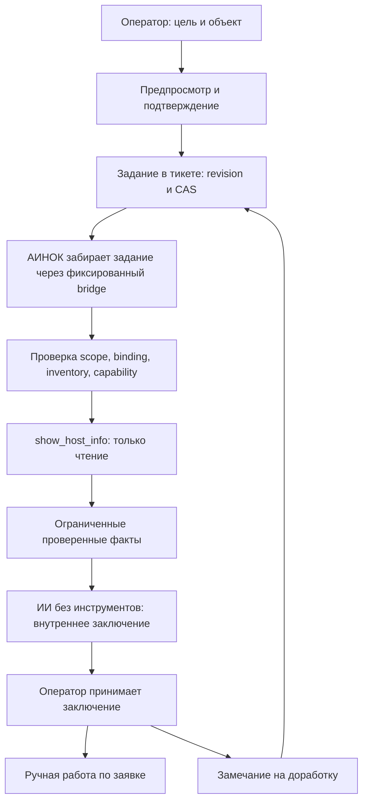

# ИИ-инженер Stage 1: локальная реализация и допуск

Дата: 2026-10-20. Ветка: `codex/support-engineer-readonly`, база `most-core@f317e34853548a7180cd6173e52dd0652811a58b`.
Архитектура: [AI_ENGINEER_ARCHITECTURE.md](AI_ENGINEER_ARCHITECTURE.md), версия 1.2.
Локальный патч одобрен независимым интеграционным ревью; оставшихся P1/P2 не обнаружено. Production установка, миграция и включение не выполнялись.

## Реализованный путь

Человеческий владелец и статус заявки сохраняются. Рекомендации не исполняются, черновик ответа автоматически клиенту не отправляется.

| Участок | Файлы и ответственность |
|---|---|
| Контракт | `src/ai-engineer.ts`: состояния, leases, TTL, фиксированный профиль, evidence refs, ограничения JSON |
| Сохранение | `src/ai-engineer-store.ts`: CAS, immutable archive, стабильный outbox и continuation для доработки |
| Authority | `src/ai-engineer-authority.ts` и существующие mutations lifecycle/ownership: epoch и запрет поздних результатов |
| Bridge | `src/ai-engineer-bridge.ts`, `src/ai-engineer-catalog.ts`: фиксированные stdin JSON операции, scope/binding, свежий каталог, индексы, watchdog |
| Генерация | Центральный AOR через `support-conclusion-v1`; bot worker выполняет только repair/outbox/readiness/card refresh, без локального вызова модели |
| Интерфейс | `src/ai-engineer-ui.ts`, hooks `staff.ts`/`ticket-ui.ts`: внутренняя форма заметки, выбор объекта, подтверждение, отмена, handoff, доработка, версии и детали |
| Запуск | `src/index.ts`, `src/ai-engineer-readiness.ts`: подготовка индексов перед допуском UI, периодическая работа, остановка до Mongo disconnect |
| Контроллер AINOC | Отдельный патч: `bin/ainoc_support_engineer_controller.py`, SQL `db/migrations/support_engineer_stage1.sql`, выключенный config example, oneshot service/timer |

Форма использует существующий compose: actor/chat/thread/expiry/version и конфликт с ручной заявкой, именем и решением. Подтверждение проверяет форму в той же атомарной записи, которая создаёт задание/доработку. Отмена и expiry во время проверки каталога блокируют admission.
Отключённую либо просроченную форму можно отменить; при следующем вводе она освобождает обычную поддержку. Сохранённые заключения доступны сотрудникам после закрытия заявки и отключения новых заданий.

## Уточнения к плану

- Цель и замечание ограничены 1000 символами. Модели передаются только очищенные операторские goal/feedback и явная проекция фактов. Автоматический экспорт переписки отсутствует, history пустое.
- Первый профиль — только `host-info-v1` → зарегистрированная `show_host_info`. Успех подтверждает доступность; числовой uptime из pretty-output не извлекается. `uptime_seconds=null`, результат `partial`, неизвестное указано явно. Это проверка транспорта и хоста, а не полноценная диагностика VPN.
- В бот не передаются SSH credentials, canonical target, маршрут, произвольные inventory facts или stdout. В АИНОК не передаётся текст задания/переписки.
- Каталог обновляется controller pull по существующему SSH→pmox8→QGA VM3902 пути. Новый listener не создаётся. Нужна явная операторская binding; пустой каталог ничего не разрешает.
- AI-события сохраняются в аудите; навигация по заключениям и редакциям идёт из постоянной карточки, отдельно от клиентской истории.
- При остановке worker отменяет SDK-запрос через AbortSignal и ждёт до 5s. Поздний ответ не публикуется, lease восстанавливается. Штатные Compose и deployment config sample сохранены байт-в-байт: существующий app-update adapter не допускает их изменений.
- AI-ready в боте разрешает UI после подготовки индексов и startup repair. Отдельный bridge читает ту же startup-конфигурацию и сам проверяет индексы до операций. Отзыв роли/отключение требует согласованного restart и отключения контроллера; общего live-readiness сервиса нет.
- Точный центральный контракт, frozen snapshot и порядок согласованного выключенного rollout описаны в [AI_ENGINEER_CENTRAL_CONCLUSION.md](AI_ENGINEER_CENTRAL_CONCLUSION.md). Policy fingerprint включает backend `ainoc-aor` и protocol `support-conclusion-v1`.
- Перед bounded repair startup одним `updateMany` повышает epoch всех незавершённых заданий и сохранённых continuation при disabled либо несовпадении policy. Возврат к прежней конфигурации не оживляет оставшиеся за пределами batch задания. Pending/outcome/feedback сохраняются.

## Локальные доказательства

Предыдущий полный gate: 55 suites, 481 tests и build успешно; Python: 9 tests и compile успешно. При подготовке установки добавлен AbortSignal для совместимости со штатным app-update контрактом: 16 focused tests прошли, build проверяется. Этот последующий патч проходит штатное AOR-ревью отдельно от локального ревью первой версии.
Покрыты повторная доставка, смена владельца/эпохи, ABA reopen, outbox/archive recovery, доработка после сбоев, старые claims/факты, лимиты попыток, роли/поверхности, отмена/expiry/замена формы при admission, evidence refs, очищенный LLM input без tools/retries, ограниченный контроллер и запрещённые targets.
State/store проверки используют in-memory либо mocked persistence. Это не доказательство работы индексов и aggregation updates на фактическом MongoDB.

## Допуск перед production

1. Независимое интеграционное ревью финального патча обоих репозиториев. Read-only наблюдение 2026-10-20: AINOC `4b4bc16`, deployed SHA VM3902 совпадает с базой бота. Перед установкой перепроверить SHA/image.
2. На отдельной MongoDB той же версии проверить unique indexes архива, aggregation pipeline, CAS отмены/transfer и сохранение старых данных. Production коллекции не удалять.
3. Получить отдельное человеческое подтверждение production edits согласно AINOC `AGENTS.md`. До него не копировать файлы в `/opt/ainoc`, не применять SQL, не запускать новый bridge/service.
4. Подготовить backup `inventory.db`, исходных файлов и образа. Python: temp copy → compile → tests → install → compile. Перезапускать только изменённый компонент, проверить active/logs.
5. SQL создаёт только две новые таблицы. Проверить реальную схему и явно разрешить одну canary binding с версией и TTL. Пример конфигурации выключен. Секреты не хранить в Git/SQLite и не выводить в проверках.
6. Обе стороны установить выключенными. Проверить stdin/QGA/Compose лимиты и индексы до допуска одной цели. Обычная поддержка продолжает работать при недоступном АИНОК.
7. Canary: цель → объект → read-only факт → внутреннее заключение → handoff → доработка/revision+1. Проверить отмену, transfer/close и поздний результат. Клиент не получает AI-текст, feedback или детали.
8. Откат: остановить timer, выключить флаги обеих сторон и согласованно перезапустить бот. Данные и архивы сохранить; деструктивная обратная миграция не нужна. Старый образ не должен удалять аддитивные поля.

Самостоятельные действия АИНОК, новые capabilities, provisioning и автоматические ответы клиенту в этот этап не входят.
