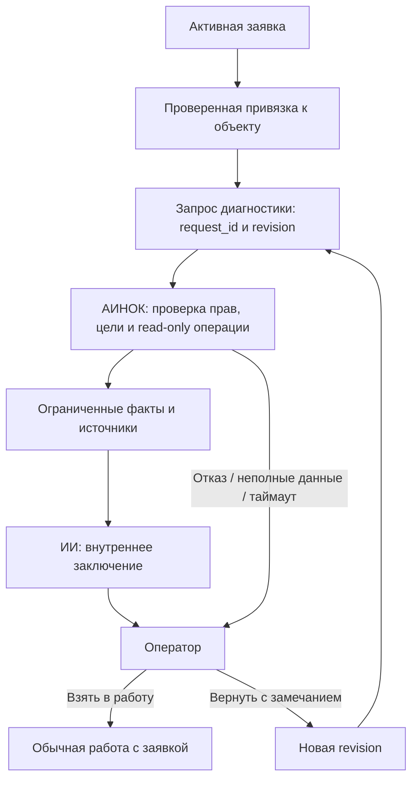

# ИИ-инженер: первый этап интеграции с АИНОК

Статус: исходный план исследования. Локальный патч описан в [AI_ENGINEER_IMPLEMENTATION.md](AI_ENGINEER_IMPLEMENTATION.md). Production интеграция ещё не включена.
Уточнённая архитектура передачи задания: [AI_ENGINEER_ARCHITECTURE.md](AI_ENGINEER_ARCHITECTURE.md); при расхождении она имеет приоритет.
Дата исследования: 2026-10-19. Прод не изменён.

## Проверенная основа

- Репозиторий: `evgmahov-blip/telegram-support-bot`; рабочая ветка `most-core`, исходный commit `f317e34853548a7180cd6173e52dd0652811a58b`.
- `master` остаётся upstream-подобной веткой и не подходит как база этой доработки.
- Production branch `most-core` подтверждена чтением project registry АИНОК.
- Контроллер `/opt/ainoc` на `ainoc-control`: наблюдавшийся HEAD `426fe8f`. Локальный AINOC `main` отличается; переносить в прод файлы из локального main целиком нельзя.
- Подтверждение ветки не является подтверждением версии запущенного контейнера бота. Перед canary сверить deployed SHA/image через существующий deployment transport.

Текущий поток бота: `handlers.ts` → `text.ts` → `users.ts` / `staff.ts` → MongoDB и `ticket-ui.ts`.
Карточка, история, авторизация рабочей группы/темы, владение, заметки и сохранение человеческого решения уже существуют.
`ai-draft.ts:createAIDraft` создаёт только внутренние черновики; `users.ts` вызывает его после обработки сообщения.
`ticket-ui.ts:history` разделяет внутреннюю и клиентскую историю.
`ticket-resolution-case.ts` сохраняет решение только для закрытой заявки; этот механизм не заменяет заключение ИИ по активной заявке.

В АИНОК имеются inventory API на loopback `127.0.0.1:8765`, registry, job orchestrator, аудит и ограниченная диагностика AOR.
`AgentOrchestrator.request_bounded_diagnosis` требует trusted Telegram backend, task version, candidate SHA и revision.
Это диагностика инцидента разработки, а не готовый API диагностики клиентского тикета. Не передавать боту `_trusted_backend`, не подделывать эти привязки.
Read-only inventory API не имеет готового support-ticket runtime-контракта. Доступность API с VM3902 не проверена; loopback контроллера с VM недоступен автоматически.

## Наблюдаемый результат этапа

Оператор открывает активную заявку, выбирает «ИИ-инженер» и запускает диагностику по подтверждённой привязке к объекту.
АИНОК получает только ограниченный запрос, собирает разрешённые факты, возвращает результат со временем проверки и источниками.
ИИ готовит внутреннее заключение: симптомы, проверенные факты, вероятная причина, что неизвестно, рекомендации и черновик ответа клиенту.
Результат остаётся на рассмотрении оператора. Оператор берёт его в работу либо возвращает ИИ с замечанием.
Повторная диагностика создаёт новую версию заключения, сохраняя предыдущую и замечание.
Ответ клиенту отправляется существующим ручным путём. Закрытие заявки и сохранение решения остаются человеческими действиями.

Первый запуск — явно из карточки, без автоматического платного анализа каждого сообщения. Это позволяет проверить полный путь, не задерживая приём обращений.

## Минимальные изменения по владельцам ответственности

| Файл | Изменение |
|---|---|
| Новый `src/ai-engineer.ts` | Координатор start/result/rework/handoff; ограниченные переходы; подготовка контекста и заключения. Без произвольных инструментов модели. |
| Новый `src/ainoc-diagnostics.ts` | Типизированный клиент согласованного support-контракта: фиксированные операции submit/status, таймаут, ограничение размера, проверка response binding. Никаких универсальных URL/HTTP/shell из текста. |
| `src/db.ts` | Аддитивные поля состояния на заявке, неизменяемые версии заключения и запросы с уникальным `(deployment_scope, ticketId, revision)`; атомарное получение запроса исполнителем. |
| `src/ticket-ui.ts` | Кнопки «ИИ-инженер», «Заключение», «Взять в работу», «Вернуть на доработку» и «Технические детали»; только маршрутизация и отображение. |
| `src/handlers.ts` / `src/text.ts` | Узкий перехват ввода замечания до обычного ответа клиенту; использовать существующий механизм ввода с actor/chat/thread/expiry/version и конфликтами других активных форм. |
| `src/addons/llm.ts` | Внутренний вызов генерации заключения с существующим клиентом; ограничение времени/контекста/ответа; без tools и исполнения рекомендаций. AI stack АИНОК не менять. |
| `src/interfaces.ts`, config sample | Один выключенный по умолчанию флаг `ai_engineer_enabled`; только необходимые параметры проверенного транспорта. Секреты — refs/secret mount, не Git. |
| Новый модуль на стороне АИНОК | Support admission adapter: доверенная identity сервиса, проверенная привязка тикета, узкий allowlist диагностик, нормализованный результат. Переиспользовать inventory и существующий executor; не создавать второй менеджер инфраструктуры. |
| Сфокусированные тесты в обоих репозиториях | Авторизация, read-only граница, гонки, повторная доставка, доработка, недоступность АИНОК, отсутствие вывода клиенту. |

Перечень — состав предполагаемого патча, не заявление о созданных runtime-файлах.
Не добавлять новый сервис, брокер, базу, универсальный агентский framework или новый сетевой listener без необходимости подтверждённого транспортного контракта.

## Данные и переходы

Существующий `ticket.status` остаётся `open | waiting_user | closed`, владелец остаётся человеком.
Отдельное состояние ИИ: `idle → queued → running → awaiting_operator → handed_off`.
Дополнительные исходы: `running → failed`; `awaiting_operator → queued` только с новым номером revision и непустым замечанием.
При ошибке повтор также создаёт новую revision; слепой повтор сетевого submit сохраняет прежний request_id.
Закрытие/перепривязка заявки, новая revision или смена владельца делают старую работу неактуальной. Результат можно сохранить как устаревшую попытку, но нельзя показывать как текущее заключение.
Повторное открытие не запускает диагностику автоматически; нужен новый запрос и актуальная привязка.

Хранить `request_id`, `revision`, `status`, `requested_by`, `expected_owner`, `binding_version`, `input_digest`, `claim_id`, `lease_until`, timestamps и ссылку на сохранённый результат.
Версия заключения содержит проверенные evidence refs, их observed_at, факты, гипотезы отдельно от фактов, неизвестные данные и рекомендации.
Не копировать всё заключение в поля результата и в заметку одновременно: один источник истины плюс ссылки в существующей истории событий.
Уникальный индекс запроса и compare-and-set по revision/claim защищают от двойного нажатия, рестарта и позднего ответа старого исполнителя.
Истёкшая lease может быть получена повторно с новым claim_id; прежний worker больше не может завершить запрос.
Сохранение результата атомарно в документе запроса. Запись события/обновление карточки повторяемы по request_id; при их сбое сохранённое заключение не генерировать заново.

## Граница АИНОК

Запрос: версия схемы, доверенный deployment identity, `request_id`, `ticket_id`, `revision`, `binding_version`, ограниченные `check_ids` и `input_digest`.
Текст клиента не задаёт asset_id, маршрут, credentials, параметры доступа или исполняемые команды. Сотрудник подтверждает привязку тикета; АИНОК проверяет её независимо для аутентифицированного сервиса.
При отсутствии привязки — «Нужна привязка к объекту», без поиска по всей инфраструктуре. Ручная заявка проходит тот же контроль.
Привязка не равна знанию ID объекта и не равна project_id `support-bot`: доступ к репозиторию бота не даёт доступ к клиентским серверам.

Allowlist — явное подмножество существующих проверенных read-only операций; `risk=read_only` и отсутствие approval сами по себе не разрешают все инструменты registry.
Начать с одной подтверждённой цели и одной проверки. `show_host_info` — кандидат для проверки транспорта, не доказательство полноценной диагностики сети/VPN.
Связь asset_id → canonical target берётся из inventory; `management='ainoc' AND enabled=1`, запрет `all`/`*`, проверка параметров сохраняются.
Результат: те же correlation fields, `status=completed|partial|denied|failed`, `execution_allowed=false`, check IDs, timestamps, ограниченные evidence refs и безопасная проекция фактов.
Произвольные inventory facts и raw stdout не отправлять модели. Выбирать поля до передачи; исключить токены, credentials, subscription URLs и персональные данные других клиентов. Regex redaction логгера не заменяет проекцию.
Модель видит только очищенные необходимые фрагменты заявки и фактов; текст обращения, заметки и feedback считаются данными, а не инструкциями для инструментов.
У результата есть предел размера и свежести; при устаревании показана дата проверки и требуется новый запуск.

## Авторизация и UX

- Рабочая группа/тема, зарегистрированная роль и `canManageTicket` проверяются при старте, возврате и передаче. Для нового действия не использовать разбор `#T...` как единственный источник идентичности заявки.
- Каждая изменяющая состояние кнопка привязана к ticket, revision, actor и актуальной карточке/сроку действия; stale callback отклоняется.
- Возврат содержит замечание 1–1000 символов. Оно никогда не попадает в клиентский reply path. При смене роли/владельца и закрытии ввод отклоняется.
- Заключение и диагностические детали доступны только сотрудникам; клиентская история и команды не раскрывают их. HTML экранируется, ответ модели не исполняется как markup.
- «Взять в работу» использует существующий ownership CAS; заключение не записывает фиктивного AI-owner. Передача конкретному сотруднику использует существующий transfer.
- АИНОК недоступен: «Заявка сохранена и доступна оператору. Диагностику получить не удалось: …» плюс повтор/детали. Ошибка не закрывает заявку и не теряет сообщение.
- Детали содержат только очищенные проверки и источники; полный сырой вывод остаётся внутри контроллера с существующим контролем доступа.

## Порядок реализации и доказательства

1. Зафиксировать транспорт и server-side binding. Проверить изоляцию VM3902 и доступный существующий маршрут; не открывать inventory API наружу и не давать контейнеру root/SSH credentials контроллера.
2. Подготовить и проверить узкий адаптер АИНОК на одной read-only проверке: неправильная identity/цель, excluded asset, broad target, write capability и посторонние параметры отвергаются до исполнения. Это обязательный backend-контракт перед включением UI.
3. Добавить выключенный UI/workflow бота, версии и CAS. Тесты: start → result → operator → rework → new result, повтор submit/result, истёкшая lease, неверный claim, закрытие, transfer и старые кнопки, ошибки сети/LLM/Mongo.
4. Доказать, что клиентская история/ответы не содержат заключение, feedback, raw output или секреты. Проверить существующие сценарии карточек, compose, manual intake и resolution.
5. После focused tests выполнить полную Jest suite и TypeScript build; на стороне АИНОК — compile/tests изменяемых Python-файлов. На этапе подготовки плана эти проверки реализации ещё не выполнялись.
6. Отдельное production review/approval, backup, установка и один canary. Для Python соблюдать temp-copy/compile/install/compile/service/logs из AGENTS.md. Не включать функцию до готовности обоих концов.

Условие окончания первого этапа: одна реальная привязанная заявка проходит безопасную read-only проверку, версионируемое внутреннее заключение, доработку и передачу оператору; сбои не мешают обычной поддержке. Пока транспорт и binding не подтверждены, не называть этап готовым к canary.

## Последующее самостоятельное действие АИНОК

Сохранять связь `ticket → diagnosis revision → evidence digest` для будущего предложения действия.
Ни одна рекомендация первого этапа не является разрешением на исполнение.
В следующем этапе отдельный action intent связывает точную capability/version, canonical target, parameters, evidence, approval, TTL, проверку результата и rollback.
Исполнение проходит существующие capability policy, human approval и job orchestrator. Возврат на доработку инвалидирует старый intent/approval; новое заключение не наследует разрешение.
Будущая автономность — отдельная явно утверждённая политика ограниченных операций, а не переключение read-only флага и не команда модели.

## Возврат к обычной поддержке

Функция по умолчанию выключена. Отключение и отзыв ролей выполняются согласованным restart с инвалидацией старой policy generation, как определено в AI_ENGINEER_ARCHITECTURE.md; hot-reload конфигурации не обещается. После этой операции новые запуски/повторы запрещены, поздние результаты старых claim/epoch не становятся текущими; уже сохранённые версии доступны сотрудникам для чтения.
Существующие тикеты, история, заметки и сохранённые решения не удаляются. Аддитивные поля/коллекция могут остаться при откате к предыдущей версии; разрушительная миграция не нужна.
